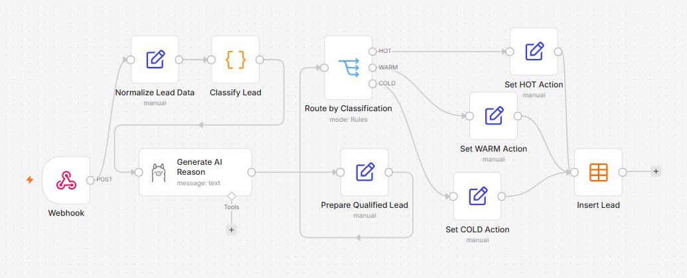
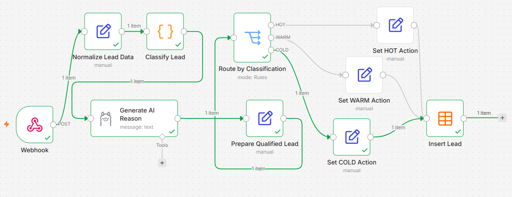
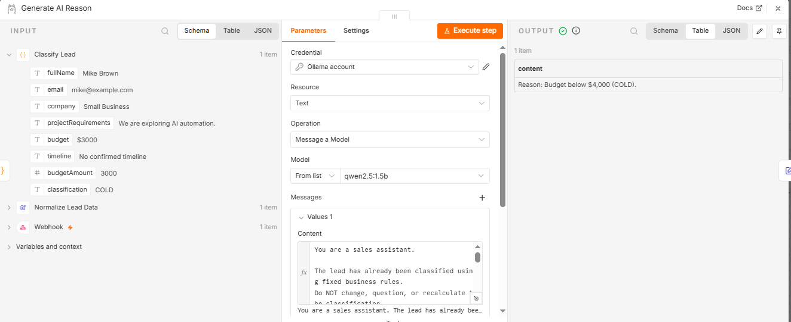
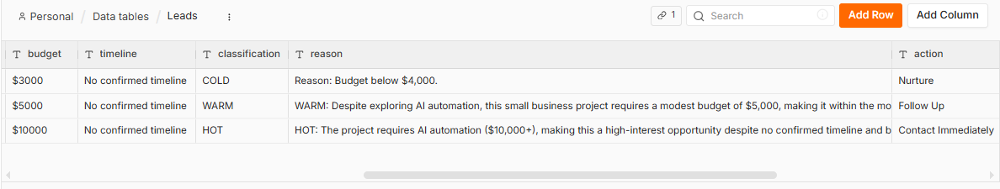

# AI Lead Qualification Automation with n8n, Ollama & Qwen

An importable n8n workflow that receives incoming leads through an HTTP webhook, classifies them using deterministic budget rules, generates a short AI-assisted explanation with a locally hosted Qwen model, assigns a follow-up action, and stores the result in an n8n Data Table.

**Key design choice:** business-critical classification stays in JavaScript; the language model explains the result rather than deciding it.

## Step-by-Step Tutorial

For a complete walkthrough of building this workflow,
including n8n configuration, Ollama integration,
JavaScript classification, and testing with Postman,
read the full article on Hashnode:

**[Read the Full Article](https://wntech.hashnode.dev/how-to-build-ai-lead-qualification-workflow-n8n-ollama-qwen)**

## Workflow overview



1. **Webhook** receives a JSON lead via HTTP POST.
2. **Normalize Lead Data** extracts the expected lead fields.
3. **Classify Lead** parses the budget and applies fixed thresholds in JavaScript.
4. **Generate AI Reason** asks Qwen via Ollama to explain the already-determined classification.
5. **Prepare Qualified Lead** retains the classification and AI explanation.
6. **Route by Classification** selects the HOT, WARM, or COLD branch.
7. **Set Action** assigns the corresponding sales follow-up action.
8. **Insert Lead** stores all categories in the same `Leads` Data Table.

## Classification rules

| Minimum parsed budget (USD) | Classification | Action |
| --- | --- | --- |
| $10,000 or more | HOT | Contact Immediately |
| $4,000–$9,999.99 | WARM | Follow Up |
| Below $4,000 | COLD | Nurture |

For a budget range (for example, `$10,000 - $15,000`), the classifier uses the **lowest parsed amount**. An unparseable budget raises an error rather than inventing a classification. These are demonstration business rules, not universal lead-scoring standards. Timeline and project requirements provide context for the AI explanation; they do **not** change the classification.

## Tech stack

- **n8n:** workflow orchestration, webhook, branching, and Data Tables
- **JavaScript:** deterministic budget parsing and classification
- **Ollama:** locally hosted model serving
- **Qwen 2.5 1.5B (`qwen2.5:1.5b`):** AI-generated explanation
- **Postman:** manual HTTP webhook testing

## Setup

### Prerequisites

- Running n8n instance with the **Data Table** node available
- Ollama running and the `qwen2.5:1.5b` model installed
- Network connectivity from n8n to Ollama

If n8n runs in Docker and Ollama runs on the host machine, `http://host.docker.internal:11434` is a common Ollama base URL on Docker Desktop. Confirm your host firewall and Ollama bind settings allow the connection; other platforms may need a different hostname.

### Import and configure

1. Download [`workflow.json`](workflow.json) and import it into a new n8n workflow.
2. Create an n8n Data Table named **`Leads`** with these **String** columns:
   - `fullName`
   - `email`
   - `company`
   - `projectRequirements`
   - `budget`
   - `timeline`
   - `classification`
   - `reason`
   - `action`
3. In **Generate AI Reason**, create/select an Ollama credential and verify the model is `qwen2.5:1.5b`.
4. In **Insert Lead**, select your local `Leads` table. Check that all nine column mappings remain populated.
5. Save the workflow. For a test request, start listening on the Webhook node's **test URL**. For persistent use, publish/activate the workflow and use its **production URL**.

The exported workflow intentionally excludes environment-specific credential references and Data Table IDs. The Data Table itself is **not** included in the workflow export.

## Test request

Send an HTTP **POST** request to the Webhook test URL shown by your n8n instance (typically `http://localhost:5678/webhook-test/lead-qualification` while listening):

```json
{
  "fullName": "John Smith",
  "email": "john@example.com",
  "company": "Example Logistics",
  "projectRequirements": "Automate customer support inquiries",
  "budget": "$10,000 - $15,000",
  "timeline": "Within 1 month"
}
```

Expected stored fields include:

```json
{
  "classification": "HOT",
  "action": "Contact Immediately",
  "reason": "<model-generated explanation>"
}
```

The webhook is configured to respond immediately, so a successful HTTP response indicates the workflow was **started**, not necessarily that all downstream nodes completed. Confirm the result in n8n executions and the `Leads` Data Table.

## Demo screenshots

**Successful workflow execution (COLD branch):**



**AI explanation generated by Qwen through Ollama:**



**Stored HOT, WARM and COLD leads with follow-up actions:**



## Why use a hybrid approach?

Early experiments delegated numeric lead classification to a small local language model. Because fixed numeric thresholds need predictable results, the final workflow separates responsibilities:

- **Code determines the classification** from parsed budget values.
- **AI produces a readable explanation** using the lead's context and fixed classification.
- **n8n routes and stores** the structured result.

The model's wording can vary, and it may include labels such as `HOT:` or `Reason:` despite prompt instructions. Treat the explanation as generated text, not as the authoritative source of classification.

## Scope and limitations

- This project **qualifies incoming leads**; it does not generate or acquire leads.
- The budget-only thresholds are a demo policy, not a comprehensive sales-scoring model.
- The workflow does not send notifications or automatically contact leads. Its `action` field is a suggested next step.
- No authentication is configured on the demo webhook. Add authentication, input validation, rate limiting, and privacy controls before exposing it publicly or using real customer information.
- The workflow is designed for a single lead per webhook request and does not implement duplicate detection or a CRM integration.

## Repository contents

```text
.
├── workflow.json
├── screenshots/
│   ├── 1workflow-overview.png
│   ├── 2workflow-execution.png
│   ├── 3ai-reason-generation.png
│   └── 4qualified-leads-results.png
└── README.md
```
